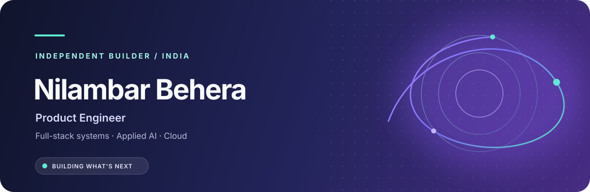

 

  

---

## ✦ A little about me

I'm **Nilambar**, an early-career Product Engineer and final-year BCA student at Bhadrak Autonomous College, India.

I build end-to-end products across **full-stack development, applied AI, data, and cloud infrastructure** — from system design and user experience to deployment and iteration.

I'm the founder of **[Mitti-AI / Saathi AI](https://saathiai.org)**, an award-winning agritech initiative combining field hardware, data engineering, and intelligent agricultural recommendations.

- 🚀 **10+** production-ready projects and engineering builds
- 🏆 **₹6,00,000** in cumulative innovation awards
- 🎓 **8.5/10 CGPA** · BCA · graduating March 2027
- 🌍 Interested in product engineering opportunities and global collaboration

---

## ✨ Things I've built

<table>
  <tr>
    <td width="50%" valign="top">
      <h3>🌱 Mitti-AI / Saathi AI</h3>
      
Precision agriculture platform connecting IoT soil sensing, data processing, and AI-assisted recommendations.

      
      
      
       <a href="https://saathiai.org">Explore Saathi AI ↗</a>
    </td>
    <td width="50%" valign="top">
      <h3>🧪 Veylith</h3>
      
AI reliability engineering project focused on systematic model evaluation, validation, and dependable behavior.

      
      
      
    </td>
  </tr>
  <tr>
    <td width="50%" valign="top">
      <h3>💳 SpendLens</h3>
      
AI-assisted financial analysis platform with deterministic spending rules, actionable insights, and shareable results.

      
      
      
    </td>
    <td width="50%" valign="top">
      <h3>📄 AI Career Architect</h3>
      
Résumé intelligence platform for PDF extraction, ATS-oriented scoring, keyword gaps, and practical feedback.

      
      
      
    </td>
  </tr>
</table>

<b>More projects</b>

 

- **LectureSnap.ai** — Chrome extension that turns YouTube lectures into timestamped screenshots and AI summaries.
- **Bistro Sequence** — Client-side video-to-image processing using Canvas API and Web Workers.
- **Kalinga Trails** — Tourism platform with destination discovery, trip-planning lead capture, and analytics.

---

## 🧩 Technology palette

**LANGUAGES**

**FRONTEND & MOBILE**

**BACKEND & DATABASES**

**DATA & MACHINE LEARNING**

 

**CLOUD & WORKFLOW**

---

## 🏅 Experience & recognition

| EXPERIENCE | DETAILS |
|:--|:--|
| **Founder & Product Engineer** | Mitti-AI / Saathi AI · Aug 2025 – Present |
| **Data Analyst Intern** | Bluestock Fintech · May – Jul 2026 |
| **AI Web Development Intern** | InAmigos Foundation · May 2026 |

---

### 🤝 Let's connect

**Have an interesting problem, product idea, or opportunity? Let's talk.**

  

Built with curiosity · Designed with intent · Shipped with care

