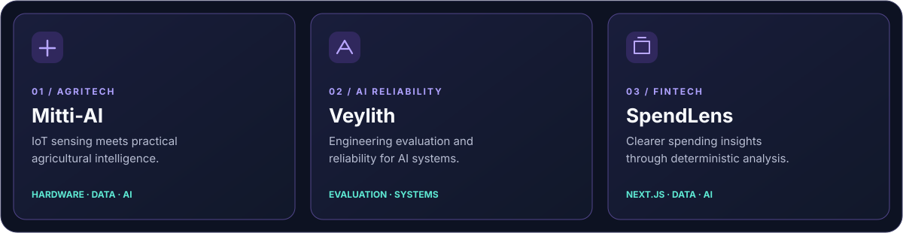

 

<a href="https://nilambarsonu.me">PORTFOLIO</a>
&nbsp;&nbsp;·&nbsp;&nbsp;
<a href="https://www.linkedin.com/in/nilambarsonu/">LINKEDIN</a>
&nbsp;&nbsp;·&nbsp;&nbsp;
<a href="https://www.kaggle.com/nilambarsonubehera">KAGGLE</a>
&nbsp;&nbsp;·&nbsp;&nbsp;
<a href="mailto:nilambarsonubehera@gmail.com">EMAIL</a>

  

 

## A little about me

I’m Nilambar — a Product Engineer from Odisha, India. I build end-to-end software across **full-stack engineering, applied AI, and cloud**.

Currently building **[Mitti-AI](https://saathiai.org)**, an award-winning agritech platform connecting field hardware, data, and intelligent recommendations.

I care about the complete product: the problem, the architecture, the experience, and what happens after deployment.

 

## Selected projects

- **Mitti-AI** — IoT-powered agricultural intelligence. [Explore](https://saathiai.org)
- **Veylith** — AI reliability and model evaluation.
- **SpendLens** — Financial analysis with deterministic insights and AI-assisted explanations.

 

## My toolkit

**PRODUCT ENGINEERING**  
`TypeScript` `JavaScript` `Python` `React` `Next.js` `React Native` `Node.js` `FastAPI`

**DATA & AI**  
`PostgreSQL` `Supabase` `Pandas` `NumPy` `scikit-learn` `PyTorch` `LLM APIs`

**CLOUD & DELIVERY**  
`AWS` `Docker` `Git` `GitHub Actions` `Vercel` `CI/CD`

 

## A few milestones

| | |
|:--|:--|
| **Founder** | Mitti-AI / Saathi AI |
| **Recognition** | 1st place — college, university and Odisha state innovation competitions |
| **Awards** | ₹6,00,000 cumulative innovation funding |
| **Experience** | Bluestock Fintech · InAmigos Foundation |
| **Education** | BCA · CGPA 8.5/10 · Graduating March 2027 |

 

### Have a meaningful problem to solve?

I’m open to product engineering opportunities and collaborations with people building useful things.

<a href="https://nilambarsonu.me"><b>EXPLORE MY WORK ↗</b></a>
&nbsp;&nbsp;·&nbsp;&nbsp;
<a href="mailto:nilambarsonubehera@gmail.com"><b>GET IN TOUCH ↗</b></a>

  

Curiosity in the details. Craft in the execution.

